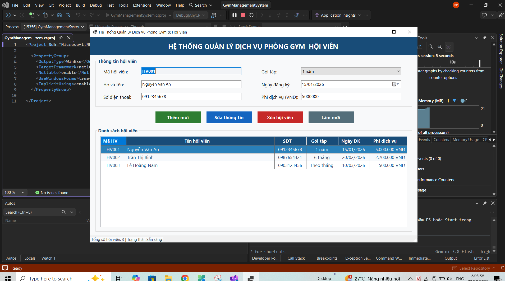
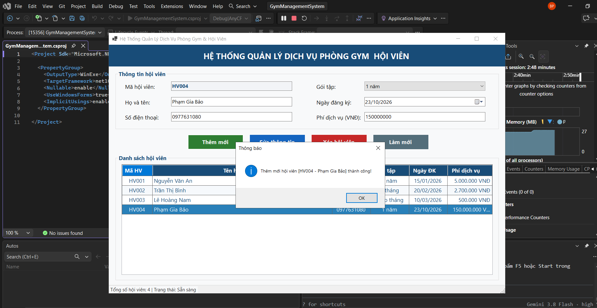
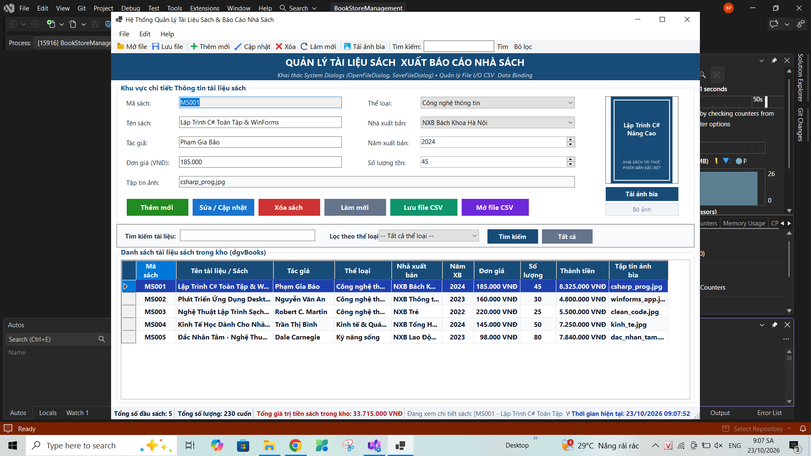
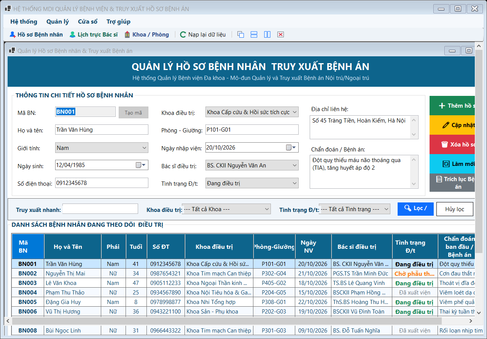
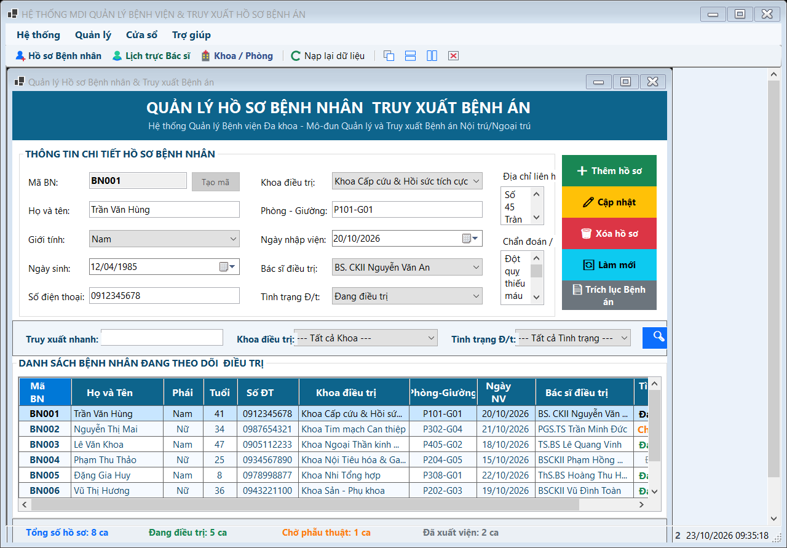
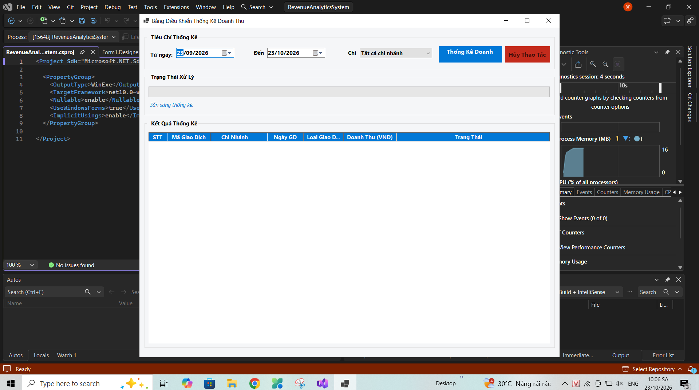
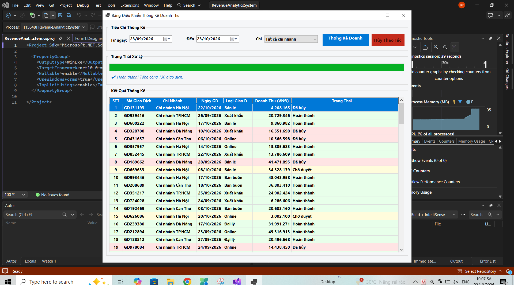
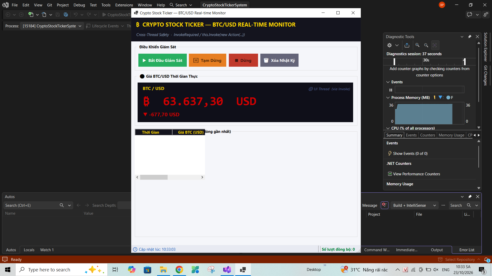
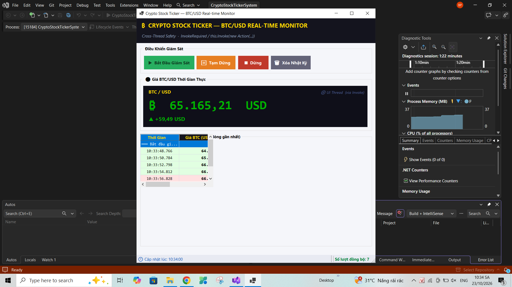

# BÁO CÁO BÀI TẬP THỰC HÀNH LẬP TRÌNH C# WINFORMS

## I. THÔNG TIN SINH VIÊN

* **Họ và tên:** Phạm Gia Bảo
* **Mã số sinh viên:** 24810320309
* **Lớp học phần:** Lập trình .NET - Mã Lớp: D19ATTT
* **Link Repository:** https://github.com/gsphamgiabao/Pham_Gia_Bao_24810320309_BaiKiemTra02

---

## II. DANH SÁCH BÀI TẬP HOÀN THÀNH & TỰ ĐÁNH GIÁ

| Bài tập | Tiêu đề bài tập | Trạng thái | Mức độ hoàn thành (%) |
| :---: | :--- | :---: | :---: |
| **Bài 1** | Quản lý Dịch vụ Phòng Gym (GymManagementSystem) | Hoàn thành | 100% |
| **Bài 2** | Quản lý Nhà sách (BookStoreManagement) | Hoàn thành | 100% |
| **Bài 3** | Quản lý Bệnh viện & Async (HospitalManagementSystem) | Hoàn thành | 100% |
| **Bài 4** | Phân tích Doanh thu (RevenueAnalyticsSystem) | Hoàn thành | 100% |
| **Bài 5** | Bảng giá Tiền điện tử & Cổ phiếu (CryptoStockTickerSystem) | Hoàn thành | 100% |

---

## III. MINH HỌA GIAO DIỆN & KỸ THUẬT NỔI BẬT

### 1. Bài 1: Quản lý Dịch vụ Phòng Gym
* **Kỹ thuật áp dụng:** Cấu hình DataGridView bằng code, Data Binding 2 chiều với `BindingSource`, Validation với `ErrorProvider`.
* **Hình ảnh minh họa Giao diện:**


*Mô tả: Giao diện chính hiển thị danh sách hội viên và thông tin dịch vụ.*


*Mô tả: Thao tác thực thi và kiểm tra dữ liệu nhập.*

---

### 2. Bài 2: Quản lý Nhà sách
* **Kỹ thuật áp dụng:** `OpenFileDialog` (Tải ảnh bìa), `SaveFileDialog` / `OpenFileDialog` (Đọc/Ghi file CSV), Cập nhật `StatusStrip` theo thời gian thực.
* **Hình ảnh minh họa Giao diện:**


*Mô tả: Quản lý thông tin sách và nạp dữ liệu tài liệu.*

---

### 3. Bài 3: Quản lý Bệnh viện (MDI & Async)
* **Kỹ thuật áp dụng:** MDI Container, Quản lý chống mở trùng Form con, `async/await` chống treo UI.
* **Hình ảnh minh họa Giao diện:**


*Mô tả: Form cha MDI điều khiển điều hướng các Form chức năng.*


*Mô tả: Xử lý dữ liệu bất đồng bộ không làm đóng băng giao diện.*

---

### 4. Bài 4: Phân tích Doanh thu (Revenue Analytics)
* **Kỹ thuật áp dụng:** Tính toán chỉ số tài chính, hiển thị bảng biểu chi tiết doanh thu.
* **Hình ảnh minh họa Giao diện:**


*Mô tả: Báo cáo tổng quan doanh thu các phân khúc.*


*Mô tả: Chi tiết lọc dữ liệu và tính toán báo cáo.*

---

### 5. Bài 5: Bảng giá Tiền điện tử & Cổ phiếu (Crypto Stock Ticker)
* **Kỹ thuật áp dụng:** Cập nhật biến động giá theo thời gian thực, xử lý đa luồng (Multithreading/Timer).
* **Hình ảnh minh họa Giao diện:**


*Mô tả: Theo dõi bảng giá chứng khoán và tiền mã hóa.*


*Mô tả: Luồng dữ liệu giá được cập nhật liên tục.*

---

## IV. HƯỚNG DẪN CÀI ĐẶT & CHẠY DỰ ÁN
1. Clone Repository về máy:
```bash
git clone [https://github.com/gsphamgiabao/Pham_Gia_Bao_24810320309_BaiKiemTra02.git](https://github.com/gsphamgiabao/Pham_Gia_Bao_24810320309_BaiKiemTra02.git)


---

## IV. HƯỚNG DẪN CÀI ĐẶT & CHẠY DỰ ÁN

1. Clone Repository về máy:
```bash
git clone [https://github.com/gsphamgiabao/Pham_Gia_Bao_24810320309_BaiKiemTra02.git](https://github.com/gsphamgiabao/Pham_Gia_Bao_24810320309_BaiKiemTra02.git)
